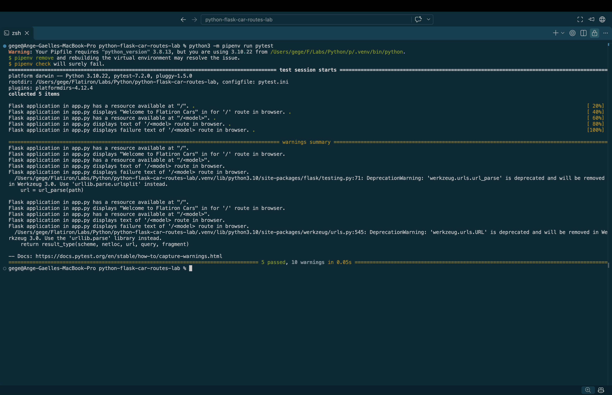

# Flask Car Routes Lab

## Description

This project is a simple Flask web application. The application uses Flask routes to display a welcome message and check whether a requested car model exists in a predefined list.

## Technologies Used

- Python 3.10
- Flask
- Pipenv
- Pytest

## Installation

1. Clone the repository:

   ```bash
   git clone git@github.com:a-gbatie/python-flask-car-routes-lab.git
   ```

2. Navigate into the project directory:

   ```bash
   cd python-flask-car-routes-lab
   ```

3. Install the dependencies:

   ```bash
   pipenv install --python 3.10
   ```

## Running the Application

Start the Flask server:

```bash
pipenv run flask --app server.app run
```

Open your browser and navigate to:

http://127.0.0.1:5000/

## Routes

### Home Route (`/`)

Displays a welcome message.

**Response:**

```text
Welcome to Flatiron Cars!
```

### Dynamic Car Model Route (`/<model>`)

Checks whether the requested car model exists in the fleet.

**Available models:**

- Beedle
- Crossroads
- M2
- Panique

**Example 1: Existing Model**

URL:

```text
http://127.0.0.1:5000/Beedle
```

Response:

```text
Flatiron Beedle is in our fleet!
```

**Example 2: Model Not Found**

URL:

```text
http://127.0.0.1:5000/Tesla
```

Response:

```text
No models called Tesla exists in our catalog.
```

## How It Works

The application uses Flask's `@app.route()` decorator to connect URLs to Python functions.

The home route returns a welcome message.

The dynamic route captures the model name from the URL and checks whether it exists in the `existing_models` list.

An `if/else` statement determines which response is returned.

## Testing

Run the automated tests using:

```bash
pipenv run pytest
```

The tests verify that the Flask routes return the expected responses.

## Screenshot of Completed Tests
